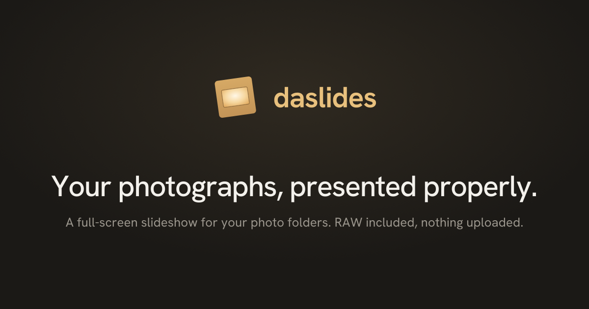

<p align="center">
  
</p>

<h1 align="center">daslides</h1>

<p align="center">
  Your photo folders, as a proper slideshow. In the browser, on your machine, nothing uploaded.
  <br><br>
  <a href="https://daslides.app/"><b>→ Open daslides</b></a>
</p>

---

Point it at a folder and it plays: full screen, smooth, hardware-accelerated.
No account, no upload, no setup. Your photos are read straight off your disk and
never leave it.

Pick a folder (or drop one on the page), press **F**, walk away. No photos to
hand? Watch the sample slideshow.

## Three ways to watch

**Ken Burns** — a slow pan and zoom across every photo, crossfading from one to
the next. The one to leave running. Give it a 10–14 second dwell.

**Fade with Zoom** — a clean crossfade, with the outgoing photo easing forward
as the next one settles in. Calm and out of the way.

**Vintage Prints** — your photos as paper prints, tilted and stacked on a table,
drifting almost imperceptibly. Each print shows the whole photo, borders and all.

The first two fill the screen edge to edge — aspect preserved, nothing
stretched, the long side cropped to fit.

## Controls

| | |
|---|---|
| `Space` | play / pause |
| `←` `→` | previous / next |
| `F` | full screen |
| `S` | settings |
| `?` | shortcuts |
| `Esc` | back out |

Settings holds the transition picker, timing, and a jumpable list of everything
in the folder. The controls fade away while it plays and come back when you move.

## What you can throw at it

JPEG, PNG, WebP, AVIF, GIF, BMP — and **RAW** from Canon, Sony, Nikon, Fujifilm,
Panasonic, Olympus and Adobe (CR2, CR3, ARW, NEF, RAF, RW2, ORF, DNG), plus
TIFF. RAW files play straight from the folder: daslides lifts out the preview
JPEG your camera already embedded, so there's no decoding to wait for.

HEIC works in Safari only — no other browser can decode it.

Subfolders are included. Thousands of photos are fine.

> **Shooting RAW for a big screen?** Embedded previews run about 1500–1600 px wide —
> great on a laptop, a little soft on a 4K TV. For those, convert once up front:
> `bash scripts/raw-to-jpeg.sh ~/Pictures/MyShoot` (macOS).

## Private by default

There is no backend. No analytics, no telemetry, no accounts, no third-party
requests — even the fonts are served with the app. Photos are read locally and
decoded in your browser.

Install it to your home screen and it runs offline.

## Run it yourself

```bash
npm install
npm run dev
```

Needs Node 22.12 or newer. `npm run build` produces a static `dist/` you can
host anywhere. daslides.app is served by Cloudflare, which builds every push to
`main`; `wrangler.jsonc` and `dist/_headers` (from `src/_headers`) configure it.

Built on WebGL2 with PixiJS, which is the only dependency — no framework, no UI
library. Add `?perf=1` for a frame-timing overlay if you're curious how it holds
up. Notes for anyone poking at the internals are in [CLAUDE.md](CLAUDE.md).

Made by [Dima Belitsky](https://github.com/dab). The code is [MIT licensed](LICENSE);
the sample photos in `public/slides` are © Dima Belitsky under
[CC BY 4.0](public/slides/LICENSE.txt) — share them freely, with credit.
